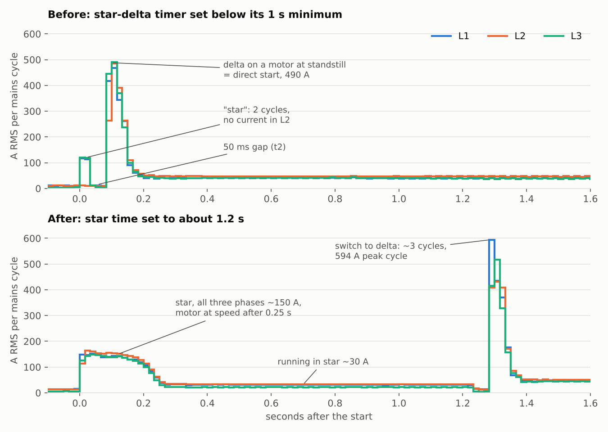

# Emporia Vue 2 as an inrush / motor start meter

This turns a stock Emporia Vue 2 into a meter that records **every motor start, cycle by cycle**, unattended:
inrush current, peak, start duration, voltage sag and frequency, with a full trace per start. It was built to
check whether battery inverters can start refrigeration compressors, and it is just as useful for pumps,
air compressors, star-delta or part-winding starters, soft starters and generators.

Per start you get (per phase in the JSON summary, maximum over the phases in the sensors):

| Value | Meaning |
|---|---|
| peak (one cycle) | highest RMS current of a single mains cycle |
| inrush 100 ms | RMS over the first 100 ms, the window a clamp meter uses in "inrush" mode |
| instant | highest single sample |
| start RMS + duration | RMS current over the whole start and how long it lasted: hold these against an inverter's overload rating (for example 150% for 10 s) |
| running | RMS of the last 0.5 s of the trace |
| Vmin, sag | lowest one-cycle voltage and the sag in % |
| f min/max | frequency range during the start |
| clipped | a CT reached the ADC limit, peak values are then too low |

Details of the measurement: [CYCLE_CAPTURE.md](CYCLE_CAPTURE.md).

## What you need

- An **Emporia Vue 2** (Gen 2). The SAMD09 firmware is for the Vue 2 only.
- A **USB-serial adapter** for the ESP32, as in the
  [emporia-vue-local hardware prep](https://emporia-vue-local.github.io/docs/tutorial/hardware-prep-v2).
- An **SWD programmer** for the SAMD09, for example a CMSIS-DAP probe (a Raspberry Pi Pico with the
  `debugprobe` firmware works), and [OpenOCD](https://openocd.org/) 0.12 or newer.
- **CTs with a higher rating** than the stock 200 A ones for anything with a real inrush. With stock CTs the
  mains inputs reach the 12-bit ADC limit at about 372 A peak (263 A RMS for a sine). 600 A CTs whose output
  at 600 A equals the stock CT at 200 A give 3x the range (`ct_multiplier: 3.0`, about 1117 A peak).
- Home Assistant with the ESPHome add-on.

## Safety

- The Vue 2 electronics are **not isolated from mains**. Never connect a USB-serial adapter, an SWD
  programmer or anything else while the Vue is connected to mains. Flash on the bench, powered from the
  adapter, then install it. After that, update over the air only.
- In a panel without neutral (see below) the whole board sits at line potential.
- Work in a distribution panel is for qualified people. Isolate and verify before you connect the voltage
  taps or the CTs.

## Step 1: flash ESPHome on the ESP32

Open the Vue and flash the ESP32 exactly as in the
[emporia-vue-local tutorial](https://emporia-vue-local.github.io/docs/tutorial/intro), but use one of the
YAML files from [`examples/`](examples) instead of the standard configuration:

| File | Use |
|---|---|
| [`examples/inrush-meter.yaml`](examples/inrush-meter.yaml) | feeder with neutral: BLACK/RED/BLUE on L1/L2/L3, WHITE on N |
| [`examples/inrush-meter-no-neutral.yaml`](examples/inrush-meter-no-neutral.yaml) | three-phase panel without neutral, max. 240 V line-to-line (two-wattmeter method) |

Both pull the component from this repository (`github://gekkehenkie11/emporia-esphome-inrush@cycle-capture`).
Add `wifi_ssid`, `wifi_password`, `fallback_password` and `api_key` (32 random bytes, base64) to your
`secrets.yaml`. Only the `substitutions` at the top need changing.

Without the new SAMD09 firmware the Vue works normally; the log then says once:

    Cycle capture: the SAMD09 does not answer the status command. Flash the cycle-capture SAMD09 firmware.

## Step 2: flash the SAMD09

The factory SAMD09 firmware only delivers 0.5 s averages. The cycle-capture firmware keeps that packet
byte-identical and adds one 32-byte record per mains cycle.

**This erases the factory SAMD09 firmware.** If the chip is read-protected it cannot be read out first. To go
back to the normal behaviour later, flash `samd09/EmporiaSamd09-standard.bin` (open-source, without cycle
capture).

### Connections

Disconnect the Vue from mains and power the board the same way as for the ESP32 (from the USB-serial
adapter). Connect the programmer to the SAMD09 (U6):

| Programmer | SAMD09 |
|---|---|
| SWDIO | PA31 / SWDIO |
| SWCLK | PA30 / SWCLK |
| nRESET (optional) | RESET |
| GND | GND |

Do not feed 3.3 V from the programmer when the board is already powered by the adapter.

> **TODO:** photo of the SWD connection points on the Vue 2 board.

### Flash with OpenOCD

From the `samd09/` folder, with a CMSIS-DAP probe:

    openocd -f interface/cmsis-dap.cfg -c "transport select swd" -f target/at91samdXX.cfg \
      -c "adapter speed 400" -c "init" -c "reset halt" \
      -c "at91samd chip-erase" -c "reset halt" -c "at91samd bootloader 0" \
      -c "program EmporiaSamd09-cycle-capture-v2.bin 0x00000000 verify reset exit"

- `chip-erase` erases the whole flash and clears a read protection; it is only needed the first time.
- `bootloader 0` clears the boot protection fuse, so that the image can be written from address 0.
- For later updates the last line alone is enough.

With another probe, replace `interface/cmsis-dap.cfg` (for example `interface/stlink.cfg`).

## Step 3: install and wire

- **Voltage:** BLACK, RED and BLUE on L1, L2 and L3 of the feeder, WHITE on N, from their own breaker. The
  frequency is measured on BLACK.
- **CTs:** mains inputs A, B and C, one around each conductor of the load's feeder, arrow towards the load.
  **Keep all three plugged in**: an open input reads the ADC limit and blocks the start detection.
- You measure everything on that feeder (for a refrigeration unit: compressor, fans and control transformer).

### Check the CT multiplier

With the load running steadily, compare one phase with a clamp meter and correct:

    new ct_multiplier = old ct_multiplier x (clamp meter current / Vue current)

### Choose the trigger

`start_trigger` (default 100 A) must be well above the running current and below the start current. The start
onset is the first cycle above half the trigger, so a first step below the trigger (star, part winding,
soft start) is included.

## Step 4: log every start in Home Assistant

Every start fires the event `esphome.compressor_start` with the device name and the JSON summary.
[`examples/ha-compressor-starts.yaml`](examples/ha-compressor-starts.yaml) writes each one as a line to
`/config/compressor_log/starts.txt` (File integration plus one automation), for example:

    2026-11-03T11:16:07.123456-04:00 motor-1 {"start":9,"cycles":330,"peak_a":{"A":594.3,"B":432.1,"C":517.3},...}

The full trace (one line per cycle, about 330 lines for 5.5 s) goes to the ESPHome log right after each start:
open the device's logs in ESPHome Builder **before** the start and download them afterwards.

## Step 5: check that it works

In the ESPHome log, after boot:

    Cycle capture: SAMD09 firmware v2, 25974 Hz frame rate, ring of 32 records
    Cycle capture: DMA interrupt timing available, ADC frame = 1848.0 CPU cycles

and once a minute:

    Cycle capture: longest DMA interrupt 33.41 us = 85.6% of the 39.05 us ADC frame (since boot 33.41 us), ADC overruns 0

- The interrupt load must stay **below 100%** (aim for less than 90%) and **ADC overruns must stay 0**;
  otherwise the SAMD09 loses samples (the line becomes a warning).
- After the first minute the frame rate is calibrated against the ESP32 clock (the SAMD09 has no crystal).
- After a start: `Start N: peak … A (one cycle), inrush 100 ms … A, …` followed by the trace lines
  `start N trace: …`. `gaps 0` and `clipped: -` mean nothing was lost or cut off.

## Reading a start: a real example

A 25 kW semi-hermetic refrigeration compressor on 127/220 V 60 Hz with a star-delta starter (nameplate:
444 A locked-rotor current in delta). The trace showed what the timer actually did:

**Before:** the "star" lasted 2 cycles and carried current in only two phases, then 50 ms without current
(the transfer time t2), then delta on a motor that was still at standstill: in effect a direct start, 490 A.
The star-delta timer was set below the minimum of its range (1–12 s), where its setting error of ±10% of full
scale makes the real time close to zero. The missing phase followed from it: the star contactor got a 50 ms
pulse and did not close properly.

**After** setting the star time to about 1.2 s (verified with the next start): all three phases ~150 A in star,
motor at speed after 0.25 s, ~30 A running in star, then a short peak of about 3 cycles (594 A peak cycle)
at the switch to delta. That peak is typical for an open-transition star-delta starter: the motor's residual
voltage is not in phase with the supply when delta closes. Its height varies from start to start.

The lesson: the peak value alone did not show the fault. The cycle trace and the 100 ms value
(108 A on L2 against 183/194 A on L1/L3) did.

## Limitations

- Vue 2 only; cycle capture covers the three mains inputs A/B/C plus two selectable 50 A inputs.
- One cycle is the time resolution (16.7 ms at 60 Hz, 20 ms at 50 Hz); the peak instant is the highest
  single ADC sample (about 26,000 ADC frames per second).
- The frequency per cycle comes from the zero crossings of BLACK; around switching moments it jumps a few
  tenths of a Hz without the supply frequency really changing.
- The SAMD09 keeps 32 cycles (about 0.5 s); the ESP reads it every 50 ms. Lost records show as `gaps`.
- Check the 100 ms inrush against a clamp meter on the same conductor once; they should agree within a few
  percent.
